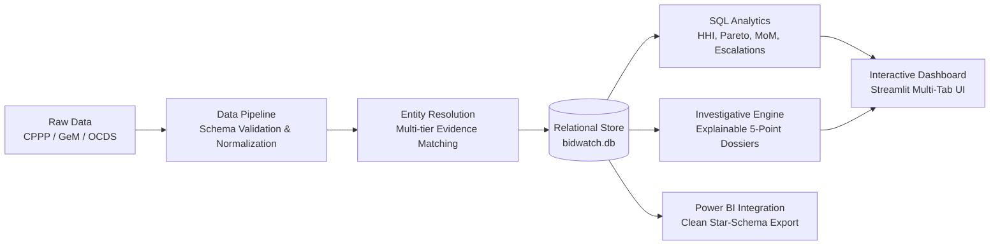

# BIDWATCH 🛡️
### Public Procurement Intelligence and Investigative Analytics Platform

[](https://www.python.org/)
[](https://sqlite.org/)
[](https://streamlit.io/)
[](https://powerbi.microsoft.com/)
[](https://creativecommons.org/licenses/by/4.0/)

---

## 1. Executive Summary & Objective

**BIDWATCH** is a portfolio-grade public procurement intelligence and investigative analytics platform designed to analyze public procurement notices, bidding competition, contract awards, and post-award corrigenda/amendments.

### Core Investigative Mission:
The platform identifies anomalous patterns that **deserve human investigation**, rather than automatically accusing suppliers or government procuring bodies of wrongdoing.

The system systematically analyzes:
- **Supplier Concentration (HHI)**: Identifying oligopolistic vendor dominance and market entry barriers.
- **Repeated Supplier Wins**: Uncovering entrenched relationships between specific departments and repeat winners.
- **Tender Participation Patterns**: Auditing single-bidder awards in open competitive tenders.
- **Contract-Value Escalation**: Detecting predatory "low-ball" bids followed by post-award expansion via repeated variation orders.
- **Compressed Bidding Windows**: Flagging abnormally short submission timelines (< 7 days) that suppress competition.
- **Chronic Tender Cancellations**: Spotting departments with elevated annulment rates.
- **Geographic Procurement Flows**: Mapping interstate vs intra-state capital allocation.

---

## 2. Platform Architecture & Data Flow



---

## 3. Technology Stack

- **Core Analytics & Pipeline**: Python 3.14, Pandas, NumPy, SQLAlchemy
- **Database Engine**: Relational SQLite3 (local) / PostgreSQL (production compatible via `DATABASE_URL`)
- **String Cleaning & Fuzzy Matching**: RapidFuzz, Python `re`, `python-dateutil`
- **Visualization & UI**: Plotly Express, Plotly Graph Objects, Streamlit
- **Testing & Verification**: Pytest (19 unit & integration tests)
- **Business Intelligence**: Power BI Star-Schema models & DAX metrics

---

## 4. Key Platform Components

### A. Conservative Entity Resolution
*Rule: Never merge two suppliers solely because their names look similar.*
- **Tier 1 (Confidence 1.00)**: Exact Tax / Corporate Registration Identifier match (PAN / CIN).
- **Tier 2 (Confidence 0.98)**: Deterministic normalized string match post legal-suffix canonicalization (`Private Limited` -> `Pvt Ltd`, `LLP`, `Inc`).
- **Tier 3 (Confidence 0.90–0.95)**: Token set/sort fuzzy similarity corroborated by geographic domicile.
- **Tier 4 (Confidence 1.00)**: Preservation of distinct canonical entity to prevent false-positive collapses.
- Every decision is recorded in the `raw_suppliers` audit table with confidence scores and evidentiary narrative.

### B. Analytical SQL Library (`sql/`)
1. [`01_department_procurement_summary.sql`](file:///c:/Users/parvk/OneDrive/Desktop/bid/sql/01_department_procurement_summary.sql): Spend, volume, average contract size, and budget utilization.
2. [`02_supplier_market_share_top_winners.sql`](file:///c:/Users/parvk/OneDrive/Desktop/bid/sql/02_supplier_market_share_top_winners.sql): Supplier market share and cumulative Pareto dominance.
3. [`03_repeat_supplier_awards.sql`](file:///c:/Users/parvk/OneDrive/Desktop/bid/sql/03_repeat_supplier_awards.sql): Buyer-supplier pairing concentration and repeat win shares.
4. [`04_supplier_concentration_hhi.sql`](file:///c:/Users/parvk/OneDrive/Desktop/bid/sql/04_supplier_concentration_hhi.sql): Herfindahl-Hirschman Index computation with DOJ antitrust classification.
5. [`05_tender_cancellation_rates.sql`](file:///c:/Users/parvk/OneDrive/Desktop/bid/sql/05_tender_cancellation_rates.sql): Department cancellation rates and annulment justifications.
6. [`06_contract_amendment_escalation.sql`](file:///c:/Users/parvk/OneDrive/Desktop/bid/sql/06_contract_amendment_escalation.sql): Post-award cost overrun and timeline delay tiers.
7. [`07_geographic_spending_distribution.sql`](file:///c:/Users/parvk/OneDrive/Desktop/bid/sql/07_geographic_spending_distribution.sql): Inter-state vs intra-state spending matrix.
8. [`08_time_trends_mom_yoy.sql`](file:///c:/Users/parvk/OneDrive/Desktop/bid/sql/08_time_trends_mom_yoy.sql): Monthly expenditure, MoM growth, and YoY trends.
9. [`09_supplier_participation_and_win_rate.sql`](file:///c:/Users/parvk/OneDrive/Desktop/bid/sql/09_supplier_participation_and_win_rate.sql): Bidding conversion rates and single-bidder win share.

### C. The 5-Point Investigative Finding Dossier
Every anomaly detected by the engine generates a structured dossier:
1. **What was observed** (Factual summary).
2. **Which data fields support the finding** (Exact JSON parameters).
3. **Why it was flagged** (Procurement compliance rationale).
4. **How it compares with the relevant baseline** (Statistical benchmark comparison).
5. **What a human investigator should verify** (Field audit checklist).

---

## 5. Quickstart Guide

### 1. Environment Setup
```bash
# Clone the repository
git clone https://github.com/your-username/bidwatch.git
cd bidwatch

# Set up virtual environment
python -m venv .venv
source .venv/bin/activate  # On Windows: .venv\Scripts\activate

# Install dependencies
pip install -r requirements.txt
```

### 2. Run Data Pipeline & Populate Database
```bash
python src/ingestion/pipeline.py
```
*Initializes `data/processed/bidwatch.db`, cleans records, performs entity resolution, and exports Power BI CSVs.*

### 3. Run Investigative Engine
```bash
python src/indicators/investigative_engine.py
```
*Scans all procurement records and generates 280 structured audit leads.*

### 4. Run Pytest Suite
```bash
pytest -v tests/
```
*Runs all 19 unit and integration tests across cleaning, entity resolution, SQL math, and indicator structures.*

### 5. Launch Interactive Dashboard
```bash
streamlit run app/main.py
```
*Opens the BIDWATCH web dashboard at `http://localhost:8501`.*

---

## 6. Directory Structure

```
bid/
├── app/
│   ├── __init__.py
│   └── main.py                     # Streamlit Analytics Dashboard
├── data/
│   ├── raw/                        # Raw sample snapshots for audit
│   └── processed/
│       ├── bidwatch.db             # Relational SQLite Database
│       └── powerbi_export/         # Power BI CSV exports
├── docs/
│   ├── PROBLEM_STATEMENT.md        # Detailed investigative problem definition
│   ├── SYSTEM_ARCHITECTURE.md      # Architecture diagrams & component flows
│   ├── ER_DIAGRAM.md               # Mermaid ER diagram & relational constraints
│   ├── DATA_DICTIONARY.md          # Complete schema table & field specs
│   ├── SQL_ANALYSIS.md             # Documented analytical SQL queries
│   ├── ANALYTICAL_METHODOLOGY.md   # Statistical baselines & indicator rules
│   ├── INVESTIGATION_GUIDE.md      # Field auditor checklist & SOPs
│   ├── DATA_QUALITY_REPORT.md      # Quality metrics & validation summary
│   ├── LIMITATIONS.md              # Real-world data & legal boundaries
│   └── POWER_BI_GUIDE.md           # Star-schema setup, DAX measures, & layout
├── sql/
│   ├── schema.sql                  # Complete relational DDL schema
│   ├── 01_department_procurement_summary.sql
│   ├── 02_supplier_market_share_top_winners.sql
│   ├── 03_repeat_supplier_awards.sql
│   ├── 04_supplier_concentration_hhi.sql
│   ├── 05_tender_cancellation_rates.sql
│   ├── 06_contract_amendment_escalation.sql
│   ├── 07_geographic_spending_distribution.sql
│   ├── 08_time_trends_mom_yoy.sql
│   └── 09_supplier_participation_and_win_rate.sql
├── src/
│   ├── analytics/
│   │   ├── __init__.py
│   │   └── queries.py              # Parameterized SQL query executor
│   ├── cleaning/
│   │   ├── __init__.py
│   │   └── normalizer.py           # Text, currency, and date standardizers
│   ├── entity_resolution/
│   │   ├── __init__.py
│   │   └── resolver.py             # Conservative evidence-based entity resolver
│   ├── indicators/
│   │   ├── __init__.py
│   │   └── investigative_engine.py # Explainable anomaly detectors
│   └── ingestion/
│       ├── __init__.py
│       ├── database.py             # DB connection & transaction management
│       └── pipeline.py             # Data ingestion, curation, and ETL runner
├── tests/
│   ├── __init__.py
│   ├── test_cleaning.py
│   ├── test_entity_resolution.py
│   ├── test_investigative_indicators.py
│   └── test_sql_analytics.py
├── DATA_SOURCES.md                 # Public procurement data sources evaluation
├── requirements.txt                # Python package dependencies
└── README.md                       # Master documentation & guide
```

---

## 7. Technical Trade-Offs & Architecture Decisions

| Design Dimension | Decision Made | Trade-Off & Technical Rationale |
| :--- | :--- | :--- |
| **Entity Resolution Strategy** | Conservative multi-tier with geographical corroboration | **Precision over Recall**: Merging two distinct suppliers creates catastrophic false-positive corruption accusations. Preserving distinct identities is strictly preferred. |
| **Anomaly Scoring vs Explainable Rules** | Statistical baselines & explainable 5-point dossiers | Avoids uninterpretable machine learning anomaly scores. Legal and audit proceedings require concrete factual violations and benchmark comparisons. |
| **Database Architecture** | Relational SQLite + SQLAlchemy DDL | Zero-dependency local execution for interview portability, while maintaining full ANSI SQL / PostgreSQL compatibility via SQLAlchemy. |
| **Dashboard Framework** | Streamlit + Plotly | Native Python data structures, ultra-responsive interactive filtering, drill-downs, and instant CSV export capabilities. |

---

## 8. Live Streamlit Dashboard & Deployment Guide

The BIDWATCH platform includes an interactive, multi-tab Streamlit dashboard engineered for vigilance officers, data journalists, and procurement auditors.

### Launch Locally:
```bash
streamlit run app/main.py
```
*(Or double-click `run_dashboard.bat` on Windows)*

### Deploy to Streamlit Community Cloud (1-Click Free Hosting):
1. Navigate to [Streamlit Community Cloud](https://share.streamlit.io/).
2. Click **"New app"**.
3. Select your repository: `Parvinder10/bidwatch`.
4. Branch: `main`.
5. Main file path: `app/main.py`.
6. Click **"Deploy!"** — the application will automatically initialize the relational database and start serving live analytics.

### Interactive Dashboard Modules:
- **📊 1. Executive Overview:** Macro spend metrics, portfolio-level cost escalation (+₹574.4 Cr), cancellation benchmark comparisons, and monthly temporal spending curves.
- **🏛️ 2. Department Spend:** Departmental budget utilization rankings, total expenditure vs sanctioned capital budget, and average contract sizes.
- **🏢 3. Supplier Concentration (HHI):** Formal Herfindahl-Hirschman Index market meter with antitrust color bands (Competitive < 1,500, Moderate 1,500–2,500, Oligopoly > 2,500) and cumulative Pareto dominance curves.
- **🔄 4. Buyer-Supplier Pairs:** Scatter plot audit of repeat wins vs captured departmental spend share (identifying contractors capturing >= 50% of departmental spend).
- **📈 5. Value Escalations:** Post-award cost growth distributions, delay days, and critical variation tiers (>50% overrun).
- **❌ 6. Cancellations & Timelines:** Department annulment rates compared to the 11% benchmark, cancellation reasons breakdown, and bidding window duration distributions.
- **🗺️ 7. Geographic Flow:** Interactive heatmap matrix tracking procurement capital flowing between buyer jurisdictions and vendor headquarter states.
- **🔍 8. Investigative Leads:** Auditable lead dossiers filterable by severity (HIGH, ELEVATED, MEDIUM) and indicator code, complete with exact JSON fields, rationale, baseline comparisons, and verification SOPs.
- **🎯 9. Record Drill-Down:** Deep-dive inspector to audit any tender reference number, reviewing notice timelines, participating price bids, award details, and sequential amendment histories.
- **📑 10. Reports & Exports:** On-demand audit report generator (Executive Briefing, Department Audit, Value Escalation Analysis) with instant Markdown (`.md`), Text (`.txt`), and CSV data exports.
