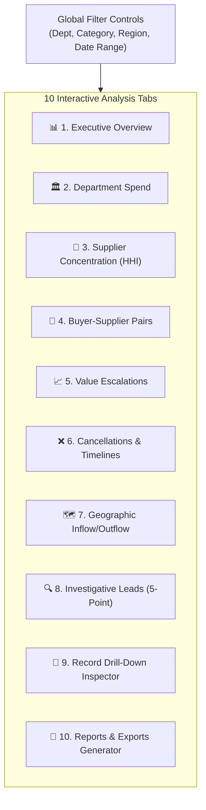

# BIDWATCH: Live Dashboard & Web Interface User Guide

## 1. Overview & Dual-Interface Architecture
The **BIDWATCH** platform is engineered with a dual presentation architecture designed to meet the operational needs of executive stakeholders, data journalists, and field procurement auditors:

1. **Full Analytical Application (Streamlit)**:
   - Hosted live on **Streamlit Community Cloud** ([`https://bidwatch.streamlit.app/`](https://bidwatch.streamlit.app/)) and runnable locally.
   - Powered by real-time Python analytics, SQLite/PostgreSQL connection via SQLAlchemy, dynamic filtering across 25 departments, and interactive deep-dive audit tools.
2. **Global Edge Web Interface (Vercel)**:
   - Hosted live on **Vercel** (`public/index.html` with `vercel.json`).
   - Ultra-fast global CDN delivery showcasing executive macro KPIs, interactive Chart.js visualizations, sample investigative lead dossiers, and direct integration links.

---

## 2. Interactive Streamlit Dashboard Walkthrough

### Tab 1: 📊 Executive Procurement Overview
- **Macro KPI Scorecard**: Displays total published tenders (1,250), awarded contracts (1,133), total settled expenditure (₹8,241 Cr), net post-award cost escalation (+₹574.4 Cr), and cancellation rate (9.36%).
- **Monthly Spend & Volume Trend**: Combined dual-axis Plotly visual displaying monthly financial outlay (bars) and contract volumes (trend line).
- **Category Donut Breakdown**: Percentage distribution of procurement capital across Works, Goods, Consulting, and Non-Consulting services.

### Tab 2: 🏛️ Department Spend & Budget Utilization
- **Department Spending Ranking**: Horizontal bar chart sorted by total settled spend, color-coded by statutory budget utilization percentage.
- **Top Department Profile**: Highlight card detailing ministry, headquarters location, total tenders awarded, average contract size, and budget adherence.
- **Searchable Table**: Full departmental roster with spending ranks and cancellation counts.

### Tab 3: 🏢 Supplier Market Share & Concentration (HHI)
- **DOJ Antitrust HHI Meter**: Measures department-level vendor concentration with statutory benchmark lines at 1,500 (Competitive) and 2,500 (Oligopoly / High Risk).
- **Pareto Dominance Curve**: Dual-axis bar and line chart illustrating the top 20 vendors by awarded contract value alongside running cumulative market share percentage.
- **MSME Participation**: Tracks contract allocation to registered Micro, Small, and Medium Enterprises.

### Tab 4: 🔄 Buyer-Supplier Repeat Wins & Entrenchment
- **Concentration Scatter Matrix**: Visualizes relationship entrenchment by plotting number of awards won against % share of department spend captured.
- **Critical Concentration Badges**: Highlights vendors capturing $\ge 50\%$ of a procuring entity's budget (e.g., *Apex Infrastructure Projects* capturing 71.2% of PWD Road Wing expenditure).

### Tab 5: 📈 Value Escalations & Contract Amendments
- **Histogram of Cost Overruns**: Distribution of contract variations from 0% to >75% escalation.
- **Escalation Tiers**: Pie chart and filtered ledger categorizing contracts into Critical (>50%), Substantial (25-50%), Moderate (10-25%), and Normal (<=10%) variations.
- **Delay Days Tracking**: Tracks timeline extensions alongside financial expansions.

### Tab 6: ❌ Cancellations & Timeline Hygiene
- **Department Cancellation Rates**: Compares individual department annulment rates against the 11% empirical platform baseline.
- **Annulment Reasons Donut**: Categorization of cancellations (Single Bidder Quoted, Administrative Prerogative, Technical Disqualification, Budget Withdrawal).
- **Bidding Duration Hygiene**: Identifies tenders published with truncated bidding windows ($\le 6$ days).

### Tab 7: 🗺️ Geographic Procurement Flows
- **Interstate Matrix Heatmap**: Cross-tabulation displaying financial flow from buyer jurisdiction states to supplier headquarter states.
- **Local Retention vs Outflow**: Donut visualization comparing domestic intra-state spending against inter-state procurement capital outflow.

### Tab 8: 🔍 Investigative Leads Dossier
- **Multi-Filter Radar**: Filter leads by Severity (`HIGH`, `ELEVATED`, `MEDIUM`), Indicator Type, and Entity Type.
- **Expandable 5-Point Audit Dossiers**:
  1. *Observed Finding*
  2. *Supporting Data Fields (JSON)*
  3. *Why It Was Flagged (Rationale)*
  4. *Comparison With Baseline*
  5. *Actionable Human Verification Checklist*

### Tab 9: 🎯 Procurement Record Deep-Dive Inspector
- **Tender Reference Search**: Dropdown to select any public notice reference (e.g., `NIT/MAH/2023/WOR/0007`).
- **Complete Lifecycle Audit**:
  - Notice metadata (dates, method, estimated budget, duration).
  - All submitted price bids with technical evaluation outcomes.
  - Final award details and winning contractor name.
  - Full amendment and variation order timeline.

### Tab 10: 📑 Investigative Reports & Data Exports
- **Interactive Report Synthesis**:
  - *Executive Vigilance & Anomaly Summary*
  - *Department Procurement Integrity Dossier* (with dynamic department picker)
  - *Contract Value Escalation & Cost Overrun Audit*
- **1-Click Export Suite**:
  - Download reports as formatted Markdown (`.md`) or Plain Text (`.txt`).
  - Download full investigative leads table (`.csv`).
  - Download clean relational tables (`tenders.csv`, `awards.csv`, `amendments.csv`).

---

## 3. Vercel Deployment Guide (`parvinder10s-projects`)

The repository includes native Vercel configuration (`vercel.json`) and a dedicated responsive web interface in `index.html` and `public/index.html`.

- **Target Vercel Account:** [https://vercel.com/parvinder10s-projects](https://vercel.com/parvinder10s-projects)
- **1-Click Direct Import Link:** [Deploy to Vercel (parvinder10s-projects)](https://vercel.com/new/clone?repository-url=https://github.com/Parvinder10/bidwatch&project-name=bidwatch)
- **Deployed Edge Portal:** `https://bidwatch.vercel.app` (or `https://bidwatch-parvinder10s-projects.vercel.app`)

### Step-by-Step Vercel Deployment:
1. Open your Vercel Dashboard at [https://vercel.com/parvinder10s-projects](https://vercel.com/parvinder10s-projects).
2. Click **"Add New..."** $\rightarrow$ **"Project"**.
3. Under *Import Git Repository*, locate **`Parvinder10/bidwatch`** and click **"Import"**.
4. Configure Project:
   - **Project Name:** `bidwatch`
   - **Framework Preset:** `Other` (Static HTML / JS Edge)
   - **Root Directory:** `./`
5. Click **"Deploy"**.
6. Within 15 seconds, Vercel deploys the global edge dashboard interface.

### Live Edge Portal Features:
- **Macro KPI HUD:** Displays active totals across 1,250 tenders, 1,133 awards, ₹8,241 Cr spend, +₹574.4 Cr escalation, and 9.36% cancellation rates.
- **Dynamic Charts:** Chart.js visualizations for Department HHI concentration scores and Category spending splits.
- **Priority Leads Matrix:** Filtered sample radar displaying High and Elevated audit leads.
- **Cross-Platform Links:** Direct links to the GitHub codebase, full documentation suite, and live Streamlit analytical application.

---

## 4. Streamlit Community Cloud Deployment Guide

1. Log in to [Streamlit Community Cloud](https://share.streamlit.io/) with your GitHub account.
2. Click **"New app"**.
3. Enter your repository details:
   - **Repository:** `Parvinder10/bidwatch`
   - **Branch:** `main`
   - **Main file path:** `app/main.py`
4. Click **"Deploy!"**.
5. The application will initialize the database and serve live analytics at:  
   👉 **`https://bidwatch.streamlit.app/`**
