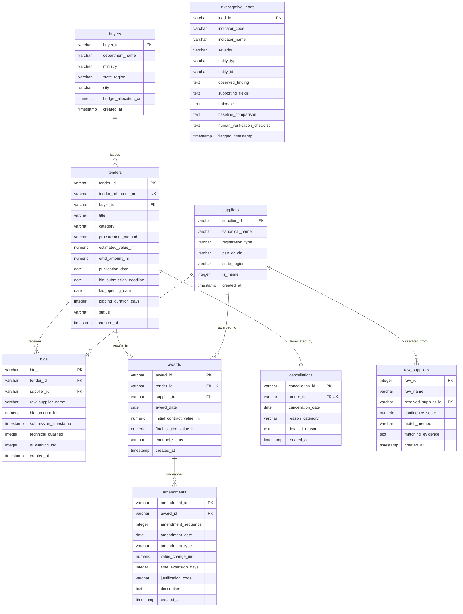

# BIDWATCH: Entity-Relationship (ER) Architecture

## 1. Relational Model Overview
The BIDWATCH data model is organized around the natural public procurement lifecycle: **Procuring Authority (Buyer) -> Tender Opportunity -> Bid Submissions -> Contract Award -> Post-Award Amendments & Cancellations**.

---

## 2. Integrity Constraints & Referential Actions
- **Primary & Foreign Keys**: All tables enforce primary keys. Foreign keys use `ON DELETE RESTRICT` for master entities (`buyers`, `suppliers`) to prevent accidental deletion, and `ON DELETE CASCADE` for child lifecycle events (`bids`, `awards`, `amendments`, `cancellations`).
- **Domain Check Constraints**:
  - `tenders.estimated_value_inr >= 0`
  - `tenders.bidding_duration_days >= 0`
  - `bids.bid_amount_inr > 0`
  - `awards.final_settled_value_inr >= awards.initial_contract_value_inr`
  - `raw_suppliers.confidence_score BETWEEN 0.0000 AND 1.0000`
- **Audit Logging**: `raw_suppliers` and `investigative_leads` act as immutable audit tables preserving both raw submission strings and automated detector findings.
