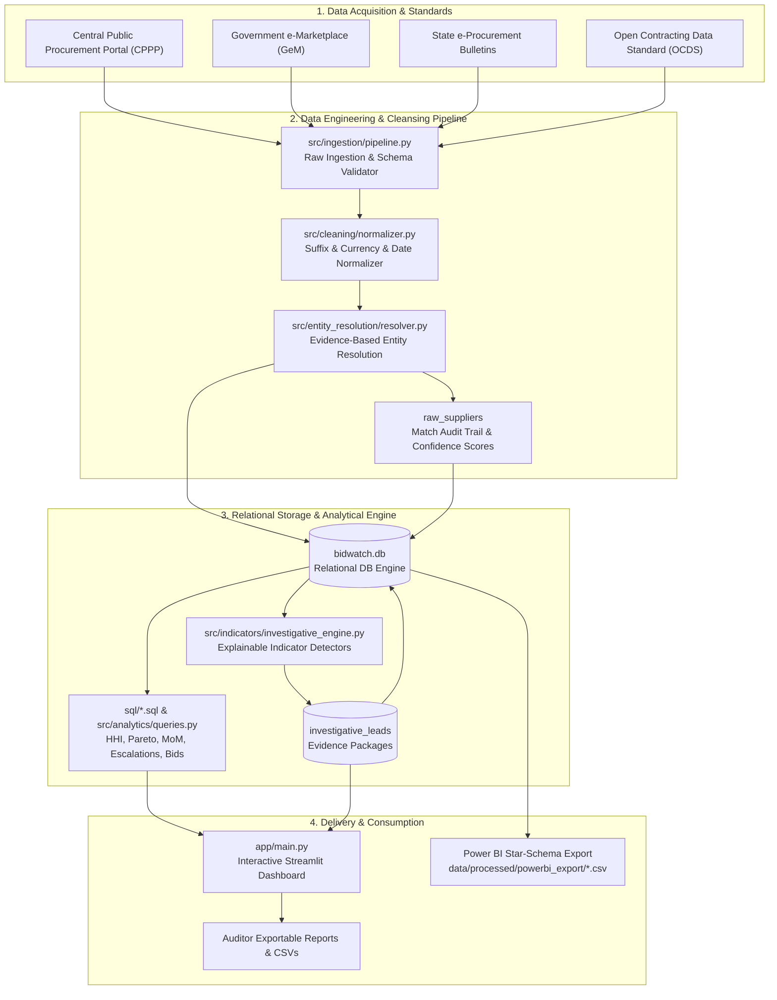

# BIDWATCH: System Architecture & Data Engineering Pipeline

## 1. High-Level Architectural Overview
**BIDWATCH** is engineered as an enterprise-grade analytics platform structured around four decoupled layers:
1. **Data Ingestion & Synthesis Layer**: Normalizes disparate public procurement records (CPPP, GeM, State Portals, OCDS) into standardized schemas.
2. **Data Cleaning & Entity Resolution Layer**: Applies deterministic and conservative corroborative fuzzy matching to resolve noisy supplier and buyer identities while preserving complete evidentiary audit trails.
3. **Storage & Relational Analytics Layer**: Relational database (SQLite local / PostgreSQL production) powered by indexed tables and a comprehensive suite of analytical SQL scripts.
4. **Investigative Intelligence & Visual Presentation Layer**: Explainable indicator engine feeding an interactive multi-tab Streamlit dashboard and Power BI tabular data models.

---

## 2. Core Architectural Components

### A. Data Ingestion & Cleansing Module (`src/cleaning/normalizer.py`)
- Standardizes corporate legal tokens (`Private Limited` -> `Pvt Ltd`, `Limited` -> `Ltd`, `LLP`, `Inc`).
- Strips non-standard punctuation and collapses irregular whitespace.
- Normalizes diverse currency representations (converting Indian Lakhs/Crores notations into standard floating-point INR values).
- Parses disparate date formats (`DD/MM/YYYY`, `DD-MM-YYYY`, `YYYY-MM-DD`, timestamps) into standard ISO dates.

### B. Conservative Entity Resolution Engine (`src/entity_resolution/resolver.py`)
- Implements a strict **4-Tier Evidence Hierarchy**:
  1. *Tier 1 (Confidence 1.00)*: Deterministic PAN / CIN / GSTIN corporate identifier match.
  2. *Tier 2 (Confidence 0.98)*: Deterministic normalized string match post legal-suffix canonicalization.
  3. *Tier 3 (Confidence 0.90-0.95)*: Token-sort/Token-set similarity corroborated by geographic domicile.
  4. *Tier 4 (Confidence 1.00)*: Segregation of new canonical identity to avoid false-positive collapses.
- **Strict Anti-Collapsing Rule**: Enforces the prompt mandate: *Never merge two suppliers solely because their names look similar*. Dissimilar jurisdictions or ambiguous corporate roots always generate distinct canonical records.
- Records every decision into `raw_suppliers` with exact method and evidentiary text.

### C. Analytical Query Engine (`src/analytics/queries.py` & `sql/`)
- Pure, portable SQL scripts using modern relational constructs: Common Table Expressions (CTEs), Window Functions (`LAG`, `OVER`, `DENSE_RANK`), Subqueries, and Exponentiation (`POWER`).
- Optimized with secondary composite indexes on `buyer_id`, `supplier_id`, `tender_id`, `publication_date`, and `award_date`.

### D. Investigative Indicators Engine (`src/indicators/investigative_engine.py`)
- Runs rule-based detectors parameterized against empirical baselines.
- Generates structured audit leads with five mandatory evidentiary pillars:
  1. Observed finding.
  2. Supporting data fields (JSON format).
  3. Rationale for flagging.
  4. Comparison with empirical baseline.
  5. Actionable human verification checklist.
